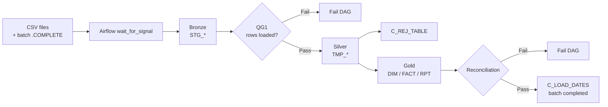

# Retail Medallion Architecture Notes

## 1. Architecture Overview

The pipeline uses Airflow to load dated retail batches into Snowflake. It is organized as a medallion architecture:

| Layer | Prefix | Purpose | Load behavior |
|---|---|---|---|
| Source | CSV / sentinel | Supply one dated batch | Daily or weekly, according to the file |
| Bronze | `STG_*` | Preserve the delivered rows | Delete and reload by `_batch_date` |
| Silver | `TMP_*` | Clean, validate, and deduplicate | Delete and reload by `_batch_date` |
| Quarantine | `C_REJ_TABLE` | Store rejected rows and rejection rules | Delete and reload by `_batch_date` |
| Gold | `DIM_*`, `FACT_*`, `RPT_*` | Apply the dimensional model and marts | Merge or rebuild per batch |

The implementation is driven by the `retail_medallion_load` DAG. SQL is kept in `include/sql/`, and control and audit data is retained in `RETAIL_DW.RETAIL_SCHEMA`.

## 2. Pipeline Flow

### 2.1 Batch trigger

The DAG waits for `batch_<YYYY-MM-DD>/.COMPLETE` before processing. This acts as a readiness marker and prevents the pipeline from reading an incomplete batch.

### 2.2 Bronze: landing and audit

The four source files are loaded into Bronze:

| Source file | Bronze table |
|---|---|
| `pos_sales_YYYYMMDD.csv` | `STG_POS_SALES` |
| `inventory_snapshot_YYYYMMDD.csv` | `STG_INVENTORY_SNAPSHOT` |
| `item_master_YYYYMMDD.csv` | `STG_ITEM_MASTER` |
| `store_master_YYYYMMDD.csv` | `STG_STORE_MASTER` |

Every Bronze load writes `_batch_date` and uses `_batch_date` as the rerun boundary.

### 2.3 Quality Gate 1

After all Bronze loads finish, `schema_gate.sql` counts rows in each Bronze table for the batch and calculates the smallest count.

- If the smallest count is `0`, the DAG fails.
- Otherwise, processing continues to Silver.

This gate is a batch-level completeness check: it does not independently validate every source column or schema.

### 2.4 Silver: validation and quarantine

Silver masters load before transaction tables:

1. `TMP_ITEM_MASTER`
2. `TMP_STORE_MASTER`
3. `TMP_POS_SALES`
4. `TMP_INVENTORY_SNAPSHOT`

This order allows POS sales to validate `item_id` against the batch's `TMP_ITEM_MASTER`.

Silver validation uses first-match rule precedence. Once a row matches a rule, it is written to `C_REJ_TABLE` and is not evaluated against later rules.

| Silver table | Rejection rules in precedence order |
|---|---|
| `TMP_ITEM_MASTER` | `NULL_PK`, `DUP_PK`, `INVALID_UNIT_PRICE`, `INVALID_EFFECTIVE_FROM` |
| `TMP_STORE_MASTER` | `NULL_PK`, `DUP_PK`, `INVALID_EFFECTIVE_FROM` |
| `TMP_POS_SALES` | `NULL_FK`, `NEG_QTY`, `DUP_LINE`, `ORPHAN_FK` |
| `TMP_INVENTORY_SNAPSHOT` | `NULL_FK`, `NEG_QTY`, `DUP_LINE` |

The `validate_quarantine` task reports the rejected-row count but does not fail the run.

### 2.5 Gold: dimensional model

Gold tables are loaded in dependency order:

1. Reference dimensions: `DIM_SUBCLASS`, `DIM_DISTRICT`, `DIM_DAY`, `DIM_CUSTOMER`
2. Core dimensions: `DIM_ITEM`, `DIM_STORE`
3. Facts: `FACT_POS_SALES`, `FACT_INVENTORY_SNAPSHOT`, `FACT_PRICE`
4. Mart: `RPT_SALES_DAILY`

Item and store changes are maintained as SCD Type 2 dimensions. Customer is maintained as SCD Type 1. Fact rows resolve surrogate keys for dates, items, stores, and customers where applicable.

### 2.6 Reconciliation and completion

`validate_reconciliation.sql` compares Silver and Gold counts for the batch. It also compares POS sales quantity in the fact table with quantity in the daily sales mart.

The reconciliation task fails the DAG on any `FAIL` result. If every check passes, `record_batch_completion` writes one completion record per target table to `C_LOAD_DATES`.

## 3. Physical Object Layout

### 3.1 Bronze

| Table | Grain / key |
|---|---|
| `STG_POS_SALES` | Line: `transaction_id` + `line_id` |
| `STG_INVENTORY_SNAPSHOT` | Snapshot: `item_id` + `location_id` + `snapshot_date` |
| `STG_ITEM_MASTER` | Item: `item_id` |
| `STG_STORE_MASTER` | Store: `location_id` |

Bronze tables contain delivered values plus `_batch_date`; they are not treated as cleaned data.

### 3.2 Silver

| Table | Grain / key | Purpose |
|---|---|---|
| `TMP_POS_SALES` | `transaction_id` + `line_id` | Validated POS lines |
| `TMP_INVENTORY_SNAPSHOT` | `item_id` + `location_id` + `snapshot_date` | Validated inventory snapshots |
| `TMP_ITEM_MASTER` | `item_id` | Validated item records |
| `TMP_STORE_MASTER` | `location_id` | Validated store records |
| `C_REJ_TABLE` | No fixed business grain | Rejected row payload and reason |

### 3.3 Gold

| Category | Table |
|---|---|
| Dimensions | `DIM_ITEM`, `DIM_STORE`, `DIM_SUBCLASS`, `DIM_DISTRICT`, `DIM_CUSTOMER`, `DIM_DAY` |
| Facts | `FACT_POS_SALES`, `FACT_INVENTORY_SNAPSHOT`, `FACT_PRICE` |
| Mart | `RPT_SALES_DAILY` |

### 3.4 Control

| Table | Purpose |
|---|---|
| `C_BATCH_LOG` | Audit status and row counts for each SQL script |
| `C_REJ_TABLE` | Batch-level quarantine payloads |
| `C_LOAD_DATES` | Latest successful load date and run ID by target table |
| `C_PARAM` | Run parameters written by audited SQL loads |
| `C_BATCH_SCRIPTS` | Script metadata and execution order |

## 4. Source Contracts

| File | Frequency | Business key | Primary columns |
|---|---|---|---|
| `pos_sales` | Daily | `transaction_id` + `line_id` | `transaction_date`, `item_id`, `location_id`, `customer_id`, `sales_qty`, `unit_price`, `extended_amount`, `payment_method` |
| `inventory_snapshot` | Daily | `item_id` + `location_id` + `snapshot_date` | `snapshot_date`, `on_hand_qty`, `on_order_qty`, `unit_cost` |
| `item_master` | Daily | `item_id` | `item_name`, `subclass_id`, `subclass_name`, `unit_price`, `unit_cost`, `effective_from` |
| `store_master` | Weekly | `location_id` | `location_name`, `district_id`, `district_name`, `region`, `effective_from` |

The `.COMPLETE` sentinel is a batch readiness marker, not a data table.

## 5. Validation Rules

### 5.1 Item master

1. Quarantine `NULL_PK` when `item_id` is null or blank.
2. Quarantine `DUP_PK` when `item_id` is repeated in the batch.
3. Quarantine `INVALID_UNIT_PRICE` when `unit_price < 0`.
4. Quarantine `INVALID_EFFECTIVE_FROM` when `effective_from` is null.

### 5.2 Store master

1. Quarantine `NULL_PK` when `location_id` is null or blank.
2. Quarantine `DUP_PK` when `location_id` is repeated in the batch.
3. Quarantine `INVALID_EFFECTIVE_FROM` when `effective_from` is null.

### 5.3 POS sales

1. Quarantine `NULL_FK` when `item_id` or `location_id` is null or blank.
2. Quarantine `NEG_QTY` when `sales_qty < 0`.
3. Quarantine `DUP_LINE` when `(transaction_id, line_id)` is repeated.
4. Quarantine `ORPHAN_FK` when `item_id` is not found in the batch's `TMP_ITEM_MASTER`.

### 5.4 Inventory snapshot

1. Quarantine `NULL_FK` when `item_id` or `location_id` is null or blank.
2. Quarantine `NEG_QTY` when `on_hand_qty < 0`.
3. Quarantine `DUP_LINE` when `(item_id, location_id, snapshot_date)` is repeated.

## 6. Reload and Idempotency

| Object | Reload behavior |
|---|---|
| Bronze `STG_*` | Delete the batch rows, then reload the file with overwrite/force behavior |
| Silver `TMP_*` | Delete batch rows, revalidate, and reinsert |
| `C_REJ_TABLE` | Delete rejected rows for the source and batch, then reinsert |
| Gold dimensions and facts | Merge by business or surrogate key |
| SCD2 item/store dimensions | Close the current row when a tracked value changes; merge on business key and `effective_from` |
| `DIM_CUSTOMER` | Merge on customer key and update in place |
| `RPT_SALES_DAILY` | Delete and rebuild rows for the batch dates |
| `C_LOAD_DATES` | Merge per target table |

Two runs for the same batch should produce the same state. The DAG also uses `max_active_runs=1` to prevent overlapping runs.

## 7. Observability and Failure Handling

Every audited SQL load writes a `RUNNING` record to `C_BATCH_LOG`, runs the script, and then updates the record to `SUCCESS` or `FAILED`. A control-table logging problem does not replace the real load error.

Rejected rows are stored as a full-row `VARIANT` payload in `C_REJ_TABLE`, together with `_batch_date`, `source_table`, `rule_rejected`, and `_rejected_at`.

| Failure | Result |
|---|---|
| Missing readiness signal | Airflow sensor times out |
| QG1 finds no rows for a Bronze table | Fail the DAG |
| Silver validation rejects a row | Quarantine the row; continue the batch |
| Reconciliation mismatch | Fail the DAG |
| All reconciliation checks pass | Record batch completion |
