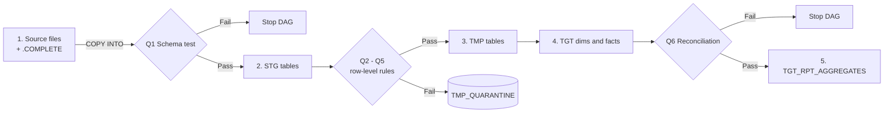

# Architecture Notes

The diagram has five layers, six quality gates and one quarantine path.

## 1. Layers at a glance

| Layer                          | Prefix     | Load type                                          |
| ------------------------------ | ---------- | -------------------------------------------------- |
| 1. Source files (landing zone) | n/a        | n/a                                                |
| 2. Staging                     | `STG_`     | Full                                               |
| 3. Transformed                 | `TMP_`     | Delta/Merge (quarantine: Append)                   |
| 4. Target                      | `TGT_`     | Merge (dims), Delta/Merge (facts), Seed (calendar) |
| 5. Marts and consumers         | `TGT_RPT_` | n/a                                                |

- **Source files:** daily and weekly CSV drops plus a `.COMPLETE` sentinel.
- **Staging:** raw, as-landed copy of each file.
- **Transformed:** cleaned, validated and conformed data.
- **Target:** the dimensional model (dimensions and facts).
- **Marts and consumers:** aggregates for BI dashboards and Finance.

## 2. Flow between layers

**Step by step**

1. **Source to STG.** The four data files and the `.COMPLETE` sentinel arrive in the landing zone. The sentinel is waited for with a timeout. The files are loaded with `COPY INTO`, but only after Q1 passes.
2. **STG to TMP.** Each STG table goes through its own chain of row-level checks. Rows that pass are merged into the matching TMP table. Rows that fail are routed to `TMP_QUARANTINE` with a reason code.
3. **TMP to TMP (derived).** `TMP_ITEM_MASTER` also feeds the subclass checks, and `TMP_STORE_MASTER` feeds the district checks. These produce the two auxiliary reference dimensions.
4. **TMP to TGT.**
   - Item and store masters merge into `TGT_DIM_ITEM` and `TGT_DIM_LOCN` (SCD2).
   - POS sales and inventory are loaded into the facts after looking up `item_sk`, `locn_sk` and `date_sk`.
   - `TGT_FCT_PRICE` takes price attributes from the item master and location attributes from the store master.
   - `TGT_DIM_DAY` (seeded calendar) and `TGT_DIM_CUSTOMER` (seeded customers) feed the facts.
5. **TGT to marts.** After Q6 passes, the facts, plus the subclass and district reference dimensions, feed `TGT_RPT_AGGREGATES`.

**Load order constraints**

- Item master must reach TMP before POS sales, because Q5 checks `item_id` against it.
- Dimensions must exist before the facts, because the facts look up their surrogate keys.

## 3. Contracts

### 3.1 Source file contracts

| File                              | Frequency     | Feeds                              |
| --------------------------------- | ------------- | ---------------------------------- |
| `pos_sales_YYYYMMDD.csv`          | Daily         | `TGT_FCT_SALES`                    |
| `inventory_snapshot_YYYYMMDD.csv` | Daily         | `TGT_FCT_INVENTORY`                |
| `item_master_YYYYMMDD.csv`        | Daily         | `TGT_DIM_ITEM`, `TGT_DIM_SUBCLASS` |
| `store_master_YYYYMMDD.csv`       | Weekly        | `TGT_DIM_LOCN`, `TGT_DIM_DISTRICT` |
| `.COMPLETE`                       | One per batch | Signals the batch is ready         |

**Rules every source file must meet**

- **Presence:** the file exists in the batch folder.
- **Schema:** its header and columns match the expected layout (checked by Q1).
- **Readiness:** the `.COMPLETE` sentinel exists. The pipeline waits for it and times out if it never appears.

**Key and columns per file** (columns taken from the implementation)

- **`pos_sales`**
  - Key: `transaction_id` + `line_id`
  - Columns: `transaction_id`, `line_id`, `transaction_date`, `item_id`, `location_id`, `customer_id`, `sales_qty`, `unit_price`, `extended_amount`, `payment_method`
- **`inventory_snapshot`**
  - Key: `item_id` + `location_id` + `snapshot_date`
  - Columns: `snapshot_date`, `item_id`, `location_id`, `on_hand_qty`, `on_order_qty`, `unit_cost`
- **`item_master`**
  - Key: `item_id`
  - Columns: `item_id`, `item_name`, `subclass_id`, `subclass_name`, `unit_price`, `unit_cost`, `effective_from`
- **`store_master`**
  - Key: `location_id`
  - Columns: `location_id`, `location_name`, `district_id`, `district_name`, `region`, `effective_from`

### 3.2 Layer contracts

**Staging (`STG_`)**

- Tables: `STG_POS_SALES`, `STG_INVENTORY`, `STG_ITEM_MASTER`, `STG_STORE_MASTER`
- Format: table / CSV. Partition: none.
- Holds the file exactly as delivered, with no cleansing.
- Only written after Q1 passes.

**Transformed (`TMP_`)**

- `TMP_POS_SALES`, `TMP_INVENTORY` (partitioned by date): only rows that passed every rule. No null keys, no negative quantities, no duplicates, no orphan items.
- `TMP_ITEM_MASTER`, `TMP_STORE_MASTER` (no partition): only rows with a valid, unique primary key and non-overlapping SCD2 dates.
- `TMP_QUARANTINE`: every rejected row with its reason code. Append only.

**Target (`TGT_`)**

- `TGT_DIM_ITEM`, `TGT_DIM_LOCN` (SCD2): business keys `item_id` / `location_id`. History kept with validity dates.
- `TGT_DIM_SUBCLASS`, `TGT_DIM_DISTRICT` (SCD2): auxiliary reference dimensions, keyed on `subclass_id` / `district_id`.
- `TGT_DIM_DAY` (SCD1): seeded calendar.
- `TGT_DIM_CUSTOMER` (SCD1): seeded and merged.
- `TGT_FCT_SALES` (transaction): grain is item, location, day, line. All dimension keys resolved.
- `TGT_FCT_INVENTORY` (positional): uses effective from and to dates.
- `TGT_FCT_PRICE` (positional): price per item, location and day.

**Marts**

- `TGT_RPT_AGGREGATES`: built only from reconciled facts. Consumed by BI dashboards and Finance.

## 4. Quality gates and rules

### 4.1 Gate overview

| Gate                             | Check                                                               | On fail                                    |
| -------------------------------- | ------------------------------------------------------------------- | ------------------------------------------ |
| **Q1** Schema test               | File exists and schema matches                                      | Stop DAG                                   |
| **Q2** Null key                  | Primary or foreign key is null                                      | Quarantine the row                         |
| **Q3** Duplicate / logic         | Duplicate key, or negative quantity                                 | Quarantine the row                         |
| **Q4** SCD2 validity / duplicate | Masters: validity dates overlap. Inventory and POS: duplicate lines | Masters: alert the team. Facts: quarantine |
| **Q5** Referential integrity     | POS `item_id` exists in `TMP_ITEM_MASTER`                           | Quarantine the row                         |
| **Q6** Reconciliation            | Target net sales equal staging net sales                            | Stop DAG                                   |

Where each gate runs:

- **Q1:** source to STG.
- **Q2 to Q4:** STG to TMP.
- **Q5:** STG to TMP, POS sales only.
- **Q6:** TGT to marts.

### 4.2 Row-level rules per dataset

Rules run in sequence. A row that fails one rule goes to quarantine and is not tested further.

- **Item master:** Q2 null `item_id` → Q3 duplicate `item_id` → Q4 SCD2 overlap. Quarantine reasons: null or duplicate PK.
- **Store master:** Q2 null `location_id` → Q3 duplicate `location_id` → Q4 SCD2 overlap. Quarantine reasons: null or duplicate PK.
- **Subclass** (from item master): Q2 null `subclass_id` → Q3 duplicate → Q4 SCD2 overlap. Quarantine reasons: null or duplicate PK.
- **District** (from store master): Q2 null `district_id` → Q3 duplicate → Q4 SCD2 overlap. Quarantine reasons: null or duplicate PK.
- **Inventory:** Q2 null item or location ID → Q3 `on_hand_qty < 0` → Q4 duplicate on item + location + date. Quarantine reasons: null FK, negative quantity, duplicate.
- **POS sales:** Q2 null item or location ID → Q3 `sales_qty < 0` → Q4 duplicate on transaction + line → Q5 `item_id` must exist in `TMP_ITEM_MASTER`. Quarantine reasons: null FK, negative quantity, duplicate, orphan.

### 4.3 What each failure action means

- **Stop DAG:** the run halts and nothing moves to the next layer. Used for problems with the whole batch (missing file, bad schema, totals that do not match).
- **Quarantine / route row:** the bad row is written to `TMP_QUARANTINE` with a reason code. The rest of the batch continues.
- **Alert: notify team:** used when SCD2 validity dates overlap in a master dataset. The team is notified.

## 5. Reload policies

| Layer                | Policy                      |
| -------------------- | --------------------------- |
| Source               | Daily (store master weekly) |
| `STG_*`              | Full                        |
| `TMP_*` data         | Delta / Merge               |
| `TMP_QUARANTINE`     | Append                      |
| SCD2 dimensions      | Merge (SCD2)                |
| `TGT_DIM_CUSTOMER`   | Merge (SCD1)                |
| `TGT_DIM_DAY`        | Seed                        |
| `TGT_FCT_*`          | Delta / Merge               |
| `TGT_RPT_AGGREGATES` | Not stated                  |

What each policy means:

- **Source:** each batch is a dated folder, signalled by `.COMPLETE`.
- **`STG_*` (Full):** each load replaces the data for the batch with the file contents.
- **`TMP_*` data (Delta / Merge):** only the batch's data is processed and merged. `TMP_POS_SALES` and `TMP_INVENTORY` are written by date. The masters are not partitioned.
- **`TMP_QUARANTINE` (Append):** rejected rows are added with a reason code and are never overwritten.
- **SCD2 dimensions** (`TGT_DIM_ITEM`, `TGT_DIM_LOCN`, `TGT_DIM_SUBCLASS`, `TGT_DIM_DISTRICT`): a change in a tracked attribute closes the current row and opens a new one. History is kept.
- **`TGT_DIM_CUSTOMER` (SCD1):** existing rows are updated in place.
- **`TGT_DIM_DAY` (Seed):** loaded once as a calendar, not driven by the daily files.
- **`TGT_FCT_*` (Delta / Merge):** only the batch's rows are merged, with dimension keys looked up.
- **`TGT_RPT_AGGREGATES`:** built only after Q6 passes.
