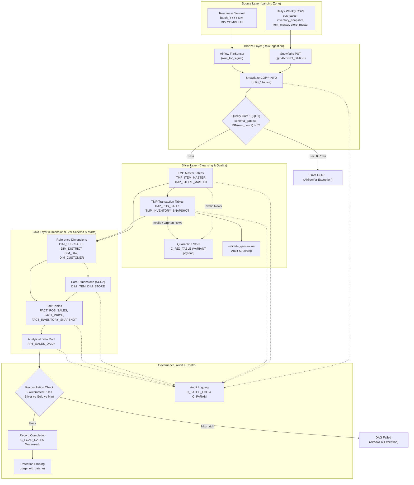

# Comprehensive Technical Review: Retail Medallion ETL Pipeline

---

## 1. Executive Summary & Architecture Overview

### 1.1 Project Mission
This project implements an enterprise-grade **Medallion Architecture ETL Pipeline** designed to ingest, cleanse, model, and aggregate multi-source daily retail data into **Snowflake** (`RETAIL_DW.RETAIL_SCHEMA`). The pipeline is orchestrated using **Apache Airflow 3.x** running on Docker with the Celery Executor, backed by PostgreSQL and Redis.

The design adheres to data engineering best practices:
- **Strict Idempotency**: Any batch date can be safely re-run without creating duplicates or inconsistent states.
- **Fail-Fast Quality Gates**: Upstream landing anomalies are caught immediately before entering downstream analytical tables.
- **Auditable Quarantine**: Malformed and invalid records are never silently dropped; they are preserved with full row context in a dedicated quarantine table.
- **Slowly Changing Dimensions (SCD Type 2)**: Historical attribute changes (e.g., store district re-assignments, item price changes) are tracked with validity intervals (`effective_from`, `effective_to`, `is_current`).
- **End-to-End Automated Reconciliation**: Silver-to-Gold row counts and fact-to-mart financial metrics are validated in real time at the end of every DAG execution.
- **Lifecycle Retention**: Configurable retention windows allow automated historical pruning across all layers.

---

### 1.2 Medallion Architecture Layers



| Layer | Physical Object Prefix | Target Grain | Quality / Cleansing Rules | Reload Strategy |
|---|---|---|---|---|
| **Source** | File system (`data/batch_YYYY-MM-DD/`) | Flat CSV files + `.COMPLETE` sentinel | None (raw external extracts) | Append-only files delivered per batch |
| **Bronze** | `STG_*` (`STG_POS_SALES`, `STG_ITEM_MASTER`, etc.) | Identical to source file lines | None. Retains raw formats, adds `_batch_date` and `_loaded_at` | `DELETE WHERE _batch_date = :batch_date` then `COPY INTO` with `FORCE=TRUE` |
| **Silver** | `TMP_*` (`TMP_POS_SALES`, `TMP_ITEM_MASTER`, etc.) | Validated, conformed business keys | De-duplication, null-check, range checks, foreign-key referential checks | `DELETE WHERE _batch_date = :batch_date` then insert cleansed rows |
| **Quarantine**| `C_REJ_TABLE` | Rejected source line | Records failing first matching rule stored as JSON `VARIANT` | `DELETE WHERE _batch_date = :batch_date AND source_table = :table` |
| **Gold** | `DIM_*`, `FACT_*`, `RPT_*` | Dimensional model & summary aggregations | Surrogate key resolution, SCD Type 2 history, calculated metrics | `MERGE` on natural/surrogate keys; partition delete-and-rebuild for marts |
| **Control** | `C_*` (`C_BATCH_LOG`, `C_LOAD_DATES`, etc.) | Audit logs, script registry, watermarks | Logging execution state, timestamps, error stacks, run watermarks | Continuous audit logging and watermarking |

---

## 2. Snowflake Initialization Files Analysis

The project root is bootstrapped via three foundational SQL initialization scripts executed directly in Snowflake.

```
d:\bootcamp\snowflake-sql\
├── 1.sql  --> Warehouse, Database, Schemas, Stages, File Formats & Staging Tables DDL
├── 2.sql  --> Metadata, Audit & Control Architecture DDL
└── 3.sql  --> Gold Layer Dimensional Model, Marts, Surrogate Keys & SCD2 Column Evolutions
```

### 2.1 File 1: `1.sql` (Infrastructure, Staging & Ingestion Setup)
- **Database & Schema**: Creates `RETAIL_DW` and schema `RETAIL_DW.RETAIL_SCHEMA`.
- **Role & Access Governance**: Switches execution context to `SYSADMIN`, grants ownership on warehouse `snowflake_learning_wh`, database, and schema to `SYSADMIN`, and applies future object grants.
- **Internal Named Stage**: Creates `landing_stage` (`RETAIL_DW.RETAIL_SCHEMA.landing_stage`) for staging files uploaded from Airflow workers via Snowflake `PUT`.
- **File Formats**:
  - `CSV_FORMAT`: Comma-delimited (`FIELD_DELIMITER = ','`), header skipping (`SKIP_HEADER = 1`), and double-quote enclosure handling (`FIELD_OPTIONALLY_ENCLOSED_BY = '"'`).
  - `PSV_FORMAT`: Pipe-delimited (`FIELD_DELIMITER = '|'`) for alternative ingestion files.
- **Staging DDLs**:
  - `STG_POS_SALES`: `transaction_id`, `line_id`, `transaction_date`, `item_id`, `location_id`, `customer_id`, `sales_qty`, `unit_price`, `extended_amount`, `payment_method`, `_batch_date`, `_loaded_at`.
  - `STG_INVENTORY_SNAPSHOT`: `snapshot_date`, `item_id`, `location_id`, `on_hand_qty`, `on_order_qty`, `unit_cost`, `_batch_date`, `_loaded_at`.
  - `STG_ITEM_MASTER`: `item_id`, `item_name`, `subclass_id`, `subclass_name`, `unit_price`, `unit_cost`, `effective_from`, `_batch_date`, `_loaded_at`.
  - `STG_STORE_MASTER`: `location_id`, `location_name`, `district_id`, `district_name`, `region`, `effective_from`, `_batch_date`, `_loaded_at`.

### 2.2 File 2: `2.sql` (Control, Governance & Audit Framework)
Defines 5 core operational tables powering metadata-driven management:
1. `C_BATCH_SCRIPTS`: Metadata registry of all pipeline SQL tasks, their architectural layer (`STG`, `TMP`, `TGT`), and expected execution sequence.
2. `C_PARAM`: Key-value audit trail of runtime parameters (such as `batch_date`) bound to specific Airflow `run_id`s.
3. `C_BATCH_LOG`: The execution audit log tracking script-level performance:
   - `log_id` (Autoincrementing primary key)
   - `run_id`, `_batch_date`, `script_name`
   - `status`: `RUNNING` -> transitioned to `SUCCESS` or `FAILED`
   - `start_time`, `end_time`
   - Metrics: `rows_read`, `rows_inserted`, `rows_rejected`
   - `error_message`: Captured exception stack trace (up to 4000 characters).
4. `C_REJ_TABLE`: The centralized quarantine store:
   - `_batch_date`: Execution date
   - `source_table`: Ingestion origin (e.g. `STG_POS_SALES`)
   - `rule_rejected`: Rejection code (e.g. `NULL_PK`, `NEG_QTY`, `ORPHAN_FK`)
   - `payload`: **Snowflake `VARIANT` type**, storing `OBJECT_CONSTRUCT(*)` JSON payloads of the rejected row.
   - `_rejected_at`: Rejection timestamp.
5. `C_LOAD_DATES`: High-watermark tracking:
   - `target_table`: Target table name
   - `last_load_date`: Latest successfully processed batch date
   - `last_run_id`: Associated Airflow execution ID
   - `updated_at`: Last update timestamp.

### 2.3 File 3: `3.sql` (Gold Layer Dimensional Model & Schema Migration)
Establishes the enterprise star schema and analytical marts:
- **Reference Dimensions**: `DIM_SUBCLASS`, `DIM_DISTRICT`, `DIM_DAY`, `DIM_CUSTOMER`.
- **Core Dimensions**: `DIM_ITEM` and `DIM_STORE`.
- **Fact Tables**: `FACT_POS_SALES`, `FACT_INVENTORY_SNAPSHOT`, `FACT_PRICE`.
- **Data Marts**: `RPT_SALES_DAILY`.
- **Schema Evolution (ALTER TABLE statements)**:
  - Adds SCD Type 2 tracking columns (`effective_to DATE DEFAULT '9999-12-31'`, `is_current BOOLEAN DEFAULT TRUE`) to `DIM_ITEM` and `DIM_STORE`.
  - Adds surrogate keys (`item_sk`, `subclass_sk`, `location_sk`, `district_sk`, `sales_line_sk`, `inventory_sk`, `date_sk`, `customer_sk`) replacing natural keys for Kimball dimensional conformance.

---

## 3. Airflow Orchestration & Pipeline Workflow

### 3.1 DAG Configuration (`dags/retail_medallion_load.py`)
- **DAG Identifier**: `retail_medallion_load`
- **Schedule**: `0 22 * * *` (Daily at 22:00 / 10 PM)
- **Timezone**: `Asia/Kathmandu`
- **Start Date**: `2026-10-01`
- **Catchup**: `False` (Prevents runaway parallel backfills upon startup)
- **Max Active Runs**: `1` (Guarantees strict sequential batch processing, eliminating race conditions across shared staging and temporary tables)

### 3.2 Sequential Workflow Execution Graph

```
wait_for_signal (FileSensor)
   │
   ▼
[TaskGroup: bronze]
   ├── load_stg.expand(file_name=SOURCE_FILES)  [Dynamic Task Mapping: 4 parallel tasks]
   └── schema_gate (QG1 Completeness Check)
   │
   ▼
[TaskGroup: silver]
   ├── load_tmp_master.expand(table_name=TMP_MASTER_TABLES)  [item_master, store_master]
   ├── load_tmp_transaction.expand(table_name=TMP_TRANSACTION_TABLES)  [pos_sales, inventory_snapshot]
   └── validate_quarantine (Logs quarantine metrics)
   │
   ▼
[TaskGroup: gold]
   ├── load_tgt_ref_dims.expand(table_name=GOLD_REF_TABLES)  [subclass, district, day, customer]
   ├── load_tgt_core_dims.expand(table_name=GOLD_DIM_TABLES)  [item_master, store_master]
   ├── load_tgt_facts.expand(table_name=GOLD_FACT_TABLES)  [pos_sales, inventory_snapshot, price]
   └── load_tgt_marts.expand(table_name=GOLD_MART_TABLES)  [sales_daily]
   │
   ▼
reconcile (validate_reconciliation.sql - 9 Automated Contract Checks)
   │
   ▼
record_batch_completion (update_c_load_dates.sql)
   │
   ▼
purge_old_batches (purge_bronze, purge_silver, purge_gold)
```

### 3.3 Task Details & Technical Mechanics
1. **Readiness Sentinel (`wait_for_signal`)**:
   - Uses `FileSensor` operating in `mode="reschedule"`.
   - Polls every 10 seconds for file existence: `data/batch_{{ ds }}/.COMPLETE`.
   - *Design rationale*: `reschedule` mode frees up Airflow worker slots while waiting, preventing slot starvation. The `.COMPLETE` marker ensures Airflow never reads half-written CSV files.
2. **Dynamic Task Mapping (`.expand()`)**:
   - Utilizes Airflow TaskFlow API Dynamic Mapping to spawn independent, concurrent worker tasks for each file/table.
   - Failures in one mapped task immediately isolate the offending entity.
3. **Execution Guardrails (Quality Gate QG1 & Reconciliation)**:
   - `schema_gate` raises `AirflowFailException` if any source table loaded 0 rows.
   - `reconcile` raises `AirflowFailException` if any of the 9 count or sum assertions evaluate to `FAIL`.
   - Both gates abort execution before the batch is watermarked as complete.

---

## 4. Deep Dive: SQL Script Explanations Across All Layers

All SQL logic is separated from Python orchestration and stored in modular templates within `include/sql/`. The templates accept parameterized variables: `{{batch_date}}`, `{{data_path}}`, `{{run_id}}`, `{{script_name}}`, and `{{cutoff}}`.

---

### 4.1 Bronze Layer (`include/sql/bronze/`)

#### 1. Ingestion Templates (`load_stg_*.sql`)
Applies to:
- `load_stg_pos_sales.sql`
- `load_stg_inventory_snapshot.sql`
- `load_stg_item_master.sql`
- `load_stg_store_master.sql`

**Implementation Pattern:**
```sql
-- Step 1: Idempotent partition clean
DELETE FROM RETAIL_DW.RETAIL_SCHEMA.STG_POS_SALES WHERE _batch_date = '{{batch_date}}';

-- Step 2: Stage local batch CSV to Snowflake Internal Stage
PUT file://{{data_path}}/batch_{{batch_date}}/pos_sales_{{batch_date}}.csv 
    @RETAIL_DW.RETAIL_SCHEMA.LANDING_STAGE/batch_{{batch_date}}/ 
    AUTO_COMPRESS=FALSE OVERWRITE=TRUE;

-- Step 3: Copy staged data into Staging Table with metadata tagging
COPY INTO RETAIL_DW.RETAIL_SCHEMA.STG_POS_SALES (
    transaction_id, line_id, transaction_date, item_id, location_id,
    customer_id, sales_qty, unit_price, extended_amount, payment_method, _batch_date
)
FROM (
    SELECT $1, $2, $3, $4, $5, $6, $7, $8, $9, $10, '{{batch_date}}'
    FROM @RETAIL_DW.RETAIL_SCHEMA.LANDING_STAGE/batch_{{batch_date}}/
)
FILE_FORMAT = (FORMAT_NAME = RETAIL_DW.RETAIL_SCHEMA.CSV_FORMAT)
PATTERN = '.*pos_sales_{{batch_date}}\\.csv'
FORCE = TRUE
ON_ERROR = 'ABORT_STATEMENT';

-- Step 4: Update execution metrics in C_BATCH_LOG
UPDATE RETAIL_DW.RETAIL_SCHEMA.C_BATCH_LOG
SET status = 'SUCCESS',
    end_time = CURRENT_TIMESTAMP(),
    rows_read = (SELECT COUNT(*) FROM RETAIL_DW.RETAIL_SCHEMA.STG_POS_SALES WHERE _batch_date = '{{batch_date}}'),
    rows_inserted = (SELECT COUNT(*) FROM RETAIL_DW.RETAIL_SCHEMA.STG_POS_SALES WHERE _batch_date = '{{batch_date}}'),
    rows_rejected = 0
WHERE run_id = '{{run_id}}' AND _batch_date = '{{batch_date}}' AND script_name = '{{script_name}}';
```
- `PUT ... OVERWRITE=TRUE`: Replaces any partially uploaded file on the stage.
- `FORCE = TRUE`: Ensures Snowflake re-reads the file even if an identical checksum was previously loaded (crucial for re-running failed batches).
- `ON_ERROR = 'ABORT_STATEMENT'`: Guarantees atomic transaction boundaries; syntax/structural malformations fail the load immediately.

#### 2. Quality Gate 1 (`bronze/schema_gate.sql`)
```sql
SELECT MIN(row_count) FROM (
    SELECT COUNT(*) AS row_count FROM RETAIL_DW.RETAIL_SCHEMA.STG_POS_SALES          WHERE _batch_date = '{{batch_date}}'
    UNION ALL
    SELECT COUNT(*) AS row_count FROM RETAIL_DW.RETAIL_SCHEMA.STG_INVENTORY_SNAPSHOT WHERE _batch_date = '{{batch_date}}'
    UNION ALL
    SELECT COUNT(*) AS row_count FROM RETAIL_DW.RETAIL_SCHEMA.STG_ITEM_MASTER        WHERE _batch_date = '{{batch_date}}'
    UNION ALL
    SELECT COUNT(*) AS row_count FROM RETAIL_DW.RETAIL_SCHEMA.STG_STORE_MASTER       WHERE _batch_date = '{{batch_date}}'
);
```
- Performs a union of row counts across all 4 staging tables for `{{batch_date}}` and takes `MIN()`.
- If any file was empty (0 rows), `MIN(row_count)` returns `0`, causing the Airflow task to raise `AirflowFailException`.

---

### 4.2 Silver Layer (`include/sql/silver/`)

The Silver layer cleanses and validates records. Master tables are processed before transaction tables so POS sales can cross-reference valid item IDs.

#### Silver Cleansing Architecture & First-Match Precedence
Silver uses a **two-pass CTE pattern**:
1. `ranked`: Uses `ROW_NUMBER() OVER(PARTITION BY <business_key> ORDER BY _loaded_at DESC)` to identify duplicates. The most recently loaded row receives `rn = 1`.
2. `validated`: Evaluates data quality rules using a SQL `CASE` statement. Because `CASE` evaluates sequentially and exits on the first true branch, **first-match rule precedence** is strictly enforced.
3. **Branch 1 (Rejection)**: Inserts rows where `rule_rejected IS NOT NULL` into `C_REJ_TABLE`, bundling the entire row into a JSON `VARIANT` column using `OBJECT_CONSTRUCT(*)`.
4. **Branch 2 (Conformed Ingestion)**: Inserts rows where `rule_rejected IS NULL` into the clean `TMP_*` table, excluding metadata columns (`rn`, `rule_rejected`).

#### Summary of Silver Data Quality Rules

| Table | Script | Rule Precedence Order | Validation Condition | Business Impact |
|---|---|---|---|---|
| `TMP_ITEM_MASTER` | `load_tmp_item_master.sql` | 1. `NULL_PK`<br>2. `DUP_PK`<br>3. `INVALID_UNIT_PRICE`<br>4. `INVALID_EFFECTIVE_FROM` | - `item_id IS NULL OR TRIM(item_id) = ''`<br>- `rn > 1`<br>- `unit_price < 0`<br>- `effective_from IS NULL` | Prevents catalog corruption, negative pricing, and dateless records. |
| `TMP_STORE_MASTER` | `load_tmp_store_master.sql` | 1. `NULL_PK`<br>2. `DUP_PK`<br>3. `INVALID_EFFECTIVE_FROM` | - `location_id IS NULL OR TRIM(location_id) = ''`<br>- `rn > 1`<br>- `effective_from IS NULL` | Ensures unique physical store hierarchy. |
| `TMP_POS_SALES` | `load_tmp_pos_sales.sql` | 1. `NULL_FK`<br>2. `NULL_FK`<br>3. `NEG_QTY`<br>4. `DUP_LINE`<br>5. `ORPHAN_FK` | - `item_id IS NULL OR TRIM(item_id) = ''`<br>- `location_id IS NULL OR TRIM(location_id) = ''`<br>- `sales_qty < 0`<br>- `rn > 1` (on txn_id, line_id)<br>- `im.item_id IS NULL` (Orphan check) | Quarantines unlinked sales, refund/returns if negative quantity, duplicate lines, and uncataloged SKUs. |
| `TMP_INVENTORY_SNAPSHOT` | `load_tmp_inventory_snapshot.sql` | 1. `NULL_FK`<br>2. `NULL_FK`<br>3. `NEG_QTY`<br>4. `DUP_LINE` | - `item_id IS NULL OR TRIM(item_id) = ''`<br>- `location_id IS NULL OR TRIM(location_id) = ''`<br>- `on_hand_qty < 0`<br>- `rn > 1` (on item, location, date) | Quarantines impossible physical stock counts and duplicate daily tallies. |

#### Quarantine Reporting (`silver/validate_quarantine.sql`)
```sql
SELECT COUNT(*) FROM RETAIL_DW.RETAIL_SCHEMA.C_REJ_TABLE WHERE _batch_date = '{{batch_date}}';
```
- Queries the total number of quarantined rows for the batch and logs it in Airflow.
- Silver quarantine does **not** fail the pipeline run, allowing valid transactions to continue downstream while alerting engineers to dirty data.

---

### 4.3 Gold Layer (`include/sql/gold/`)

Gold implements Kimball dimensional modeling principles, divided into 4 dependency stages:

```
Stage 1: Reference Dimensions  -->  Stage 2: Core SCD2 Dims  -->  Stage 3: Facts  -->  Stage 4: Data Marts
```

#### 1. Reference Dimensions
- **`load_tgt_subclass.sql`**:
  - Source: Distinct `subclass_id`, `subclass_name` from `TMP_ITEM_MASTER`.
  - Surrogate Key: Deterministic 64-bit integer hash: `HASH(subclass_id)`.
  - Load Logic: `MERGE INTO DIM_SUBCLASS` on `subclass_id`. Updates if incoming batch date is greater than or equal to current.
- **`load_tgt_district.sql`**:
  - Source: Distinct `district_id`, `district_name`, `region` from `TMP_STORE_MASTER`.
  - Surrogate Key: `HASH(district_id)`.
  - Load Logic: `MERGE INTO DIM_DISTRICT` on `district_id`.
- **`load_tgt_day.sql`**:
  - Pre-populates a 10-year calendar (3,653 days from `2020-01-01`) using Snowflake's table generator: `TABLE(GENERATOR(ROWCOUNT => 3653))`.
  - Attributes: `date_sk` (numeric `YYYYMMDD`), `day_of_week_num` (ISO 1–7), `day_name`, `month_num`, `month_name`, `quarter_num`, `year_num`, `is_weekend` (`DAYOFWEEKISO > 5`).
  - Idempotent `MERGE` ensuring zero duplicates.
- **`load_tgt_customer.sql`**:
  - Implements **SCD Type 1 (in-place updates)**.
  - Surrogate Key: `HASH(customer_id)`.
  - Generates synthetic record `'UNKNOWN'` (`customer_sk = HASH('UNKNOWN')`) to gracefully resolve missing customer keys in anonymous retail transactions.
  - Tracks customer lifecycle: `first_seen_date` preserved via `COALESCE(target.first_seen_date, source.first_seen_date)`, and `last_seen_date` updated via `GREATEST(...)`.

#### 2. Core Dimensions (SCD Type 2 Implementation)
Both `load_tgt_item_master.sql` and `load_tgt_store_master.sql` implement Slowly Changing Dimensions Type 2 without complex windowed lookbacks by executing a coordinated **Two-Step Update + Merge**:

##### Step 1: Expire Active Version on Attribute Change
```sql
UPDATE RETAIL_DW.RETAIL_SCHEMA.DIM_ITEM AS target
SET effective_to = source.effective_from,
    is_current   = FALSE,
    _loaded_at   = CURRENT_TIMESTAMP()
FROM (
    SELECT i.item_id, i.effective_from, i.item_name, i.subclass_id, i.unit_price, i.unit_cost
    FROM RETAIL_DW.RETAIL_SCHEMA.TMP_ITEM_MASTER i
    WHERE i._batch_date = '{{batch_date}}'
) AS source
WHERE target.item_id = source.item_id
  AND target.is_current = TRUE
  AND target.effective_from < source.effective_from
  AND (
      COALESCE(target.subclass_id, '') <> COALESCE(source.subclass_id, '')
      OR COALESCE(target.item_name, '') <> COALESCE(source.item_name, '')
      OR COALESCE(target.unit_price, -1) <> COALESCE(source.unit_price, -1)
      OR COALESCE(target.unit_cost, -1) <> COALESCE(source.unit_cost, -1)
  );
```
- Finds the current active record (`is_current = TRUE`).
- If any tracked attribute changed and the incoming `effective_from` is newer, sets `effective_to = source.effective_from` and `is_current = FALSE`.

##### Step 2: Merge Incoming Version with New Surrogate Key
```sql
MERGE INTO RETAIL_DW.RETAIL_SCHEMA.DIM_ITEM AS target
USING (
    SELECT
        HASH(i.item_id, i.effective_from) AS item_sk,
        i.item_id, i.item_name, i.subclass_id, sc.subclass_sk, i.subclass_name,
        i.unit_price, i.unit_cost, i.effective_from,
        TO_DATE('9999-12-31') AS effective_to,
        TRUE AS is_current,
        i._batch_date, i._loaded_at
    FROM RETAIL_DW.RETAIL_SCHEMA.TMP_ITEM_MASTER i
    LEFT JOIN RETAIL_DW.RETAIL_SCHEMA.DIM_SUBCLASS sc ON i.subclass_id = sc.subclass_id
    WHERE i._batch_date = '{{batch_date}}'
) AS source
ON target.item_sk = source.item_sk
WHEN MATCHED THEN UPDATE SET ...
WHEN NOT MATCHED THEN INSERT ...;
```
- Surrogate key is compound: `HASH(item_id, effective_from)`.
- If re-running the same batch date, the record matches on `item_sk` and simply updates in-place without generating false duplicate rows.

#### 3. Fact Tables
- **`load_tgt_pos_sales.sql`**:
  - Grain: Individual sales line item (`sales_line_sk = HASH(transaction_id, line_id)`).
  - Dimension Keys Lookup:
    - `DIM_ITEM`: Point-in-time temporal join (`p.transaction_date >= di.effective_from AND p.transaction_date < di.effective_to`).
    - `DIM_STORE`: Point-in-time temporal join (`p.transaction_date >= ds.effective_from AND p.transaction_date < ds.effective_to`).
    - `DIM_DAY`: Natural match on `full_date = transaction_date`.
    - `DIM_CUSTOMER`: Resolves `customer_sk` (or maps to `UNKNOWN` customer).
  - Idempotent `MERGE` on `(transaction_id, line_id)`.
- **`load_tgt_inventory_snapshot.sql`**:
  - Grain: Daily stock position per store (`inventory_sk = HASH(item_id, location_id, snapshot_date)`).
  - Idempotent strategy: Deletes batch date rows first (`DELETE ... WHERE _batch_date = '{{batch_date}}'`), then executes a `MERGE` joining against temporal dimension versions.
- **`load_tgt_price.sql`**:
  - Grain: Item price effective timeline (`price_sk = HASH(item_id, effective_from)`).
  - Derives financial metric: `unit_margin = ROUND(unit_price - unit_cost, 2)`.

#### 4. Analytical Data Mart (`load_tgt_sales_daily.sql`)
- Purpose: Aggregated reporting mart serving executive dashboards and BI reporting.
- Grain: Day x Store x Item (`date_sk`, `location_sk`, `item_sk`).
- Measures Computed:
  - `line_count`: `COUNT(*)`
  - `transaction_count`: `COUNT(DISTINCT transaction_id)`
  - `total_qty`: `SUM(sales_qty)`
  - `total_sales_amount`: `SUM(extended_amount)`
  - `total_cost`: `SUM(sales_qty * di.unit_cost)`
  - `gross_margin`: `total_sales_amount - total_cost`
- Refresh Strategy: Partition-level delete and insert.
  ```sql
  DELETE FROM RETAIL_DW.RETAIL_SCHEMA.RPT_SALES_DAILY
  WHERE date_sk IN (
      SELECT DISTINCT date_sk FROM RETAIL_DW.RETAIL_SCHEMA.FACT_POS_SALES
      WHERE _batch_date = '{{batch_date}}'
  );
  ```
  Prevents stale aggregated figures upon batch backfill.

---

## 5. Automated Data Reconciliation Concept & Implementation

### 5.1 Purpose of Data Reconciliation
In enterprise data warehousing, pipeline success cannot be declared merely because an Airflow task exited with return code `0`. Upstream joins might silently drop records (e.g. unhandled inner joins), aggregation logic might lose lines, or surrogate key resolution might fail.

Reconciliation acts as a **runtime integrity auditor** verifying that:
1. Every validated Silver row reached Gold.
2. No dimensional lookups resulted in lost rows.
3. Financial measures in summarized reporting marts match the raw underlying fact tables down to the cent and unit.

### 5.2 The 9 Reconciliation Assertions (`reconcile/validate_reconciliation.sql`)

```sql
WITH checks AS (
    -- 1. Item Master: Silver count == Gold DIM_ITEM count
    SELECT 'ITEM_MASTER' AS check_name,
        (SELECT COUNT(*) FROM RETAIL_DW.RETAIL_SCHEMA.TMP_ITEM_MASTER WHERE _batch_date = '{{batch_date}}') AS source_rows,
        (SELECT COUNT(*) FROM RETAIL_DW.RETAIL_SCHEMA.DIM_ITEM WHERE _batch_date = '{{batch_date}}') AS target_rows

    UNION ALL
    -- 2. Store Master: Silver count == Gold DIM_STORE count
    SELECT 'STORE_MASTER',
        (SELECT COUNT(*) FROM RETAIL_DW.RETAIL_SCHEMA.TMP_STORE_MASTER WHERE _batch_date = '{{batch_date}}'),
        (SELECT COUNT(*) FROM RETAIL_DW.RETAIL_SCHEMA.DIM_STORE WHERE _batch_date = '{{batch_date}}')

    UNION ALL
    -- 3. Subclass: Distinct subclasses in Silver == Matched in DIM_SUBCLASS
    SELECT 'SUBCLASS',
        (SELECT COUNT(DISTINCT subclass_id) FROM RETAIL_DW.RETAIL_SCHEMA.TMP_ITEM_MASTER WHERE _batch_date = '{{batch_date}}' AND subclass_id IS NOT NULL),
        (SELECT COUNT(DISTINCT s.subclass_id) FROM RETAIL_DW.RETAIL_SCHEMA.TMP_ITEM_MASTER s JOIN RETAIL_DW.RETAIL_SCHEMA.DIM_SUBCLASS d ON d.subclass_id = s.subclass_id WHERE s._batch_date = '{{batch_date}}')

    UNION ALL
    -- 4. District: Distinct districts in Silver == Matched in DIM_DISTRICT
    SELECT 'DISTRICT',
        (SELECT COUNT(DISTINCT district_id) FROM RETAIL_DW.RETAIL_SCHEMA.TMP_STORE_MASTER WHERE _batch_date = '{{batch_date}}' AND district_id IS NOT NULL),
        (SELECT COUNT(DISTINCT s.district_id) FROM RETAIL_DW.RETAIL_SCHEMA.TMP_STORE_MASTER s JOIN RETAIL_DW.RETAIL_SCHEMA.DIM_DISTRICT d ON d.district_id = s.district_id WHERE s._batch_date = '{{batch_date}}')

    UNION ALL
    -- 5. Customer: Distinct customers in POS Sales == Gold customer records
    SELECT 'CUSTOMER',
        (SELECT COUNT(DISTINCT customer_id) FROM RETAIL_DW.RETAIL_SCHEMA.TMP_POS_SALES WHERE _batch_date = '{{batch_date}}' AND customer_id IS NOT NULL AND TRIM(customer_id) <> ''),
        (SELECT COUNT(*) FROM RETAIL_DW.RETAIL_SCHEMA.DIM_CUSTOMER WHERE _batch_date = '{{batch_date}}' AND customer_id <> 'UNKNOWN')

    UNION ALL
    -- 6. POS Sales Fact: Silver validated lines == FACT_POS_SALES lines
    SELECT 'POS_SALES',
        (SELECT COUNT(*) FROM RETAIL_DW.RETAIL_SCHEMA.TMP_POS_SALES WHERE _batch_date = '{{batch_date}}'),
        (SELECT COUNT(*) FROM RETAIL_DW.RETAIL_SCHEMA.FACT_POS_SALES WHERE _batch_date = '{{batch_date}}')

    UNION ALL
    -- 7. Inventory Fact: Silver snapshot rows == FACT_INVENTORY_SNAPSHOT rows
    SELECT 'INVENTORY',
        (SELECT COUNT(*) FROM RETAIL_DW.RETAIL_SCHEMA.TMP_INVENTORY_SNAPSHOT WHERE _batch_date = '{{batch_date}}'),
        (SELECT COUNT(*) FROM RETAIL_DW.RETAIL_SCHEMA.FACT_INVENTORY_SNAPSHOT WHERE _batch_date = '{{batch_date}}')

    UNION ALL
    -- 8. Price Fact: Silver items == FACT_PRICE rows
    SELECT 'PRICE',
        (SELECT COUNT(*) FROM RETAIL_DW.RETAIL_SCHEMA.TMP_ITEM_MASTER WHERE _batch_date = '{{batch_date}}'),
        (SELECT COUNT(*) FROM RETAIL_DW.RETAIL_SCHEMA.FACT_PRICE WHERE _batch_date = '{{batch_date}}')

    UNION ALL
    -- 9. Mart Metric Rollup: SUM(sales_qty) in FACT == SUM(total_qty) in RPT_SALES_DAILY
    SELECT 'SALES_DAILY',
        (SELECT COALESCE(SUM(sales_qty), 0) FROM RETAIL_DW.RETAIL_SCHEMA.FACT_POS_SALES WHERE _batch_date = '{{batch_date}}'),
        (SELECT COALESCE(SUM(total_qty), 0) FROM RETAIL_DW.RETAIL_SCHEMA.RPT_SALES_DAILY WHERE _batch_date = '{{batch_date}}')
)
SELECT check_name, source_rows, target_rows,
       IFF(EQUAL_NULL(source_rows, target_rows), 'PASS', 'FAIL') AS result
FROM checks
ORDER BY check_name;
```

### 5.3 Airflow Enforcement & Watermarking
In `retail_medallion_load.py`:
- Task `reconcile` executes this SQL via `run_query_all`.
- It iterates over the results and prints a status table:
  ```
  PASS CUSTOMER       silver=2 gold=2
  PASS DISTRICT       silver=2 gold=2
  PASS INVENTORY      silver=15 gold=15
  PASS ITEM_MASTER    silver=5 gold=5
  PASS POS_SALES      silver=5 gold=5
  PASS PRICE          silver=5 gold=5
  PASS SALES_DAILY    silver=9 gold=9
  PASS STORE_MASTER   silver=3 gold=3
  PASS SUBCLASS       silver=2 gold=2
  ```
- If any check returns `FAIL`, an `AirflowFailException` is raised immediately.
- Only when all 9 checks pass does the pipeline proceed to `record_batch_completion`, executing `update_c_load_dates.sql` to advance the warehouse watermark.

---

## 6. Retention & Lifecycle Pruning Concepts

### 6.1 Architectural Need
While cloud storage is inexpensive, maintaining multi-year high-frequency staging (`STG_*`), temporary (`TMP_*`), and transaction quarantine (`C_REJ_TABLE`) data creates unnecessary Snowflake compute overhead during partition pruning and inflates table metadata.

### 6.2 Retention Configuration
In `dags/retail_medallion_load.py`:
- `DEFAULT_RETENTION_DAYS = 365` (1 year default).
- Controlled dynamically via Airflow Variables:
  - `retention_days`: Integer threshold.
  - `enable_purge`: Boolean flag (defaults to `False`).
- **Safety Guardrails**:
  - If `enable_purge` is not explicitly `true`, `1`, or `yes`, the task exits safely.
  - If `retention_days < 0` or `> 1825` (5+ years), purging is automatically disabled to protect long-term enterprise archives.

### 6.3 Layer-by-Layer Purge Implementation
When enabled, the DAG executes three targeted SQL pruning scripts:
1. **Bronze (`purge_bronze.sql`)**:
   - `DELETE FROM STG_item_master WHERE _batch_date < '{{cutoff}}';`
   - `DELETE FROM STG_store_master WHERE _batch_date < '{{cutoff}}';`
   - `DELETE FROM STG_pos_sales WHERE _batch_date < '{{cutoff}}';`
   - `DELETE FROM STG_inventory_snapshot WHERE _batch_date < '{{cutoff}}';`
2. **Silver (`purge_silver.sql`)**:
   - Deletes from `TMP_*` tables and deletes resolved quarantine logs from `C_REJ_TABLE` older than the cutoff.
3. **Gold (`purge_gold.sql`)**:
   - Prunes aging dimensional versions, transaction facts, and aggregate mart rows older than the corporate retention window.

---

## 7. Python Scripts, Helpers & Automated Test Suite

### 7.1 Synthetic Data Generation (`scripts/generate_data.py`)
Produces 5 consecutive days of landing batches (`2026-10-18` to `2026-10-22`).
To thoroughly prove the robustness of the data quality and SCD2 architecture, specific data scenarios and anomalies were injected:
- **SCD2 Store Reassignment (Day 3 / 2026-10-20)**: `STORE02` changes from `DISTRICT_NORTH` to `DISTRICT_SOUTH`. This forces the pipeline to close the active store record and create a new SCD2 version.
- **Injected Data Quality Defects on 2026-10-20**:
  - `NULL_FK`: Two POS sales lines generated with empty `item_id`.
  - `NEG_QTY`: One sales line generated with `sales_qty = -1`.
  - `ORPHAN_FK`: One sales line generated with uncataloged SKU `SKU999`.
  - `DUP_LINE`: Transaction `TXN010`, line 1 repeated twice.
- **Sentinel Emission**: Emits `batch_<date>/.COMPLETE` upon successfully writing all 4 CSVs per batch folder.

### 7.2 Database Helper Module (`include/helpers.py`)
- `_load_sql(filename, params)`: Reads SQL templates and injects parameter values.
- `_sql_str(value)`: Sanitizes strings against SQL injection by escaping single quotes (`'` -> `''`) and backslashes (`\` -> `\\`).
- `run_sql(filename, params)`: Uses `SnowflakeHook` with `split_statements=True` to execute multi-statement SQL files.
- `run_sql_audited(script_name, sql_file, params)`: Wraps execution with three-phase logging:
  1. Writes `RUNNING` status to `C_BATCH_LOG` via `log_start.sql`.
  2. Runs the target SQL script.
  3. Updates log to `SUCCESS` via `log_success.sql` or `FAILED` with error stack trace via `log_failed.sql`.
  - *Fault-Tolerant Logging Principle*: A failure while updating the audit log is caught and logged to standard logging; it **never hides or overrides the real load error**, and never fails a task whose business load succeeded.

### 7.3 Automated Test Suite (`tests/`)

```
tests/
├── test_generate_data.py   --> Validates test data synthesis and CSV formatting
├── test_helpers.py         --> Validates SQL templating, escaping, and audit resilience
└── test_sql_contracts.py   --> Validates data contracts, quality rules, and idempotency
```

#### Test Suite Breakdown

| Test File | Test Case | What It Asserts |
|---|---|---|
| `test_generate_data.py` | `test_write_csv_escapes_delimiters_and_quotes` | Verifies CSV writer properly escapes embedded commas, quotes, and newlines. |
| | `test_main_generates_complete_batch_fixtures` | Confirms all 5 batch directories are created with `.COMPLETE` markers and valid CSVs. |
| `test_helpers.py` | `test_load_sql_substitutes_parameters` | Verifies `{{batch_date}}` parameter substitution leaves no unrendered tags. |
| | `test_load_sql_reports_missing_file` | Asserts `FileNotFoundError` is raised for invalid SQL file paths. |
| | `test_sql_str_escapes_quotes_and_backslashes` | Confirms SQL escaping converts `O'Brien\data` to `O''Brien\\data`. |
| | `test_run_sql_audited_records_success` | Asserts exact execution order: `log_start` -> target SQL -> `log_success`. |
| | `test_run_sql_audited_preserves_load_error...` | Confirms the root cause exception is preserved if the audit logging itself throws an OS error. |
| | `test_run_sql_audited_does_not_fail_after_success...`| Confirms task succeeds even if `log_success.sql` encounters an intermittent connection glitch. |
| `test_sql_contracts.py` | `test_all_sql_templates_use_supported_parameters`| Scans every `.sql` template to ensure only whitelisted parameters are used. |
| | `test_schema_gate_checks_each_bronze_source...` | Verifies `schema_gate.sql` tests all 4 staging tables using `MIN(row_count)`. |
| | `test_silver_sql_contains_the_documented_rules` | Asserts exact rejection rule tokens exist in corresponding Silver SQL scripts. |
| | `test_silver_rejects_by_first_matching_rule_only` | Validates CASE statement ordering to guarantee first-match rule priority. |
| | `test_reconciliation_checks_all_datasets` | Asserts all 9 datasets are verified using `IFF(EQUAL_NULL(...))` and `'PASS'`/`'FAIL'` outputs. |
| | `test_bronze_load_stg_is_idempotent` | Verifies `OVERWRITE`, `FORCE`, and partition delete statements exist in all Bronze loads. |
| | `test_silver_is_idempotent` | Verifies Silver scripts delete previous batch records from both `TMP_*` and `C_REJ_TABLE`. |

---

## 8. Reviewer & Evaluation Focus Areas (Project Defense Checklist)

When presenting this project during a code review or technical interview, evaluators will typically drill into architectural trade-offs, edge cases, and engineering decisions. Below is the preparation guide:

### 1. How is strict Idempotency achieved?
*Answer*:
- In **Bronze**, the script executes `DELETE FROM STG_* WHERE _batch_date = :date` prior to calling `COPY INTO ... FORCE = TRUE`. Staged files use `OVERWRITE = TRUE`.
- In **Silver**, previous batch entries in both `TMP_*` and `C_REJ_TABLE` are deleted prior to inserting cleansed and quarantined records.
- In **Gold Core Dimensions**, updates and inserts are handled via `MERGE` on deterministic composite surrogate keys (`HASH(item_id, effective_from)`). Re-running does not produce duplicate rows or extra SCD2 versions.
- In **Marts**, daily aggregated partitions for that batch date are deleted and completely recalculated.
- In **Airflow**, `max_active_runs = 1` guarantees that concurrent runs cannot interleave.

### 2. Why use `HASH()` surrogate keys instead of Snowflake `AUTOINCREMENT` / Sequences?
*Answer*:
- `AUTOINCREMENT` sequences in distributed data warehouses introduce coordination bottlenecks and are non-deterministic across re-runs.
- `HASH(natural_key, effective_from)` provides a **pure, deterministic surrogate key**. If the same record is processed twice, it computes the exact same surrogate key, allowing deterministic `MERGE` conditions without distributed key generation services.

### 3. Why store quarantined records as `VARIANT` using `OBJECT_CONSTRUCT(*)`?
*Answer*:
- Storing rejected payloads as semi-structured JSON in a single Snowflake `VARIANT` column decouples quarantine schema management from source schema evolution.
- If a source file adds new columns or changes data types, the quarantine table (`C_REJ_TABLE`) requires zero DDL changes. Furthermore, the complete original row is captured for audit inspection without loss of fidelity.

### 4. How does the SCD Type 2 logic prevent duplicate versions when re-running?
*Answer*:
- The expiration query (`UPDATE ... SET is_current = FALSE, effective_to = source.effective_from`) only triggers if `target.effective_from < source.effective_from` AND at least one tracked attribute has changed.
- If re-running the same batch, `target.effective_from == source.effective_from`, so the expiration step is a no-op.
- The subsequent `MERGE` matches on `HASH(natural_key, effective_from)` and simply updates attributes in place without appending a duplicate record.

### 5. Why is POS Sales loaded after Item Master in Silver?
*Answer*:
- To enforce referential integrity at the ingestion boundary.
- `load_tmp_pos_sales.sql` performs a `LEFT JOIN` against `TMP_ITEM_MASTER` for that same batch date. If `im.item_id IS NULL`, the transaction line is flagged with `ORPHAN_FK` and routed to `C_REJ_TABLE`, preventing ghost transactions from reaching the fact tables.

### 6. What happens if a zero-byte file is received?
*Answer*:
- In Bronze, the `COPY INTO` command loads 0 rows into `STG_*`.
- Immediately following Bronze, `schema_gate.sql` executes Quality Gate 1 (`QG1`). It calculates `MIN(row_count)`.
- Because the empty table has 0 rows, the task raises `AirflowFailException`, halting the DAG before Silver or Gold tables can be affected.

### 7. What is the difference between Pytest contracts and Runtime Reconciliation?
*Answer*:
- **Pytest (`test_sql_contracts.py`)** runs at build/CI time. It statically checks SQL syntax, template parameters, rule presence, and statement ordering without requiring a live Snowflake connection.
- **Runtime Reconciliation (`validate_reconciliation.sql`)** runs inside Snowflake at the end of every live pipeline run, asserting that row counts across layers and financial metrics between fact and mart match.

---

## 9. File & Directory Reference Map

```
d:\bootcamp\assignment_2_3\
├── dags\
│   └── retail_medallion_load.py      --> Main Airflow DAG orchestrating the pipeline
├── include\
│   ├── helpers.py                    --> SnowflakeHook wrappers & audited SQL execution
│   └── sql\
│       ├── bronze\
│       │   ├── load_stg_*.sql        --> Ingestion scripts for 4 raw sources
│       │   └── schema_gate.sql       --> Quality Gate 1 (completeness check)
│       ├── silver\
│       │   ├── load_tmp_*.sql        --> Cleansing, deduplication & quarantine routing
│       │   └── validate_quarantine.sql --> Quarantined rows count audit
│       ├── gold\
│       │   ├── init_gold.sql         --> Gold layer DDL & schema migrations
│       │   ├── load_tgt_subclass.sql --> Subclass reference dimension
│       │   ├── load_tgt_district.sql --> District reference dimension
│       │   ├── load_tgt_day.sql      --> Pre-populated 10-year calendar dimension
│       │   ├── load_tgt_customer.sql --> SCD Type 1 customer dimension
│       │   ├── load_tgt_item_master.sql --> SCD Type 2 item dimension
│       │   ├── load_tgt_store_master.sql--> SCD Type 2 store dimension
│       │   ├── load_tgt_pos_sales.sql--> POS sales transaction fact
│       │   ├── load_tgt_inventory_snapshot.sql --> Inventory periodic snapshot fact
│       │   ├── load_tgt_price.sql    --> Effective pricing fact
│       │   └── load_tgt_sales_daily.sql --> Daily sales aggregate data mart
│       ├── control\
│       │   ├── init_control.sql      --> Control & audit tables DDL
│       │   ├── log_start.sql         --> Logs RUNNING status to C_BATCH_LOG
│       │   ├── log_success.sql       --> Logs SUCCESS status to C_BATCH_LOG
│       │   ├── log_failed.sql        --> Logs FAILED status and error stack
│       │   ├── seed_scripts.sql      --> Seeds C_BATCH_SCRIPTS execution registry
│       │   └── update_c_load_dates.sql --> Updates batch watermark in C_LOAD_DATES
│       ├── reconcile\
│       │   └── validate_reconciliation.sql --> 9-point Silver vs Gold integrity assertion
│       ├── purge_bronze.sql          --> Prunes aging Bronze records
│       ├── purge_silver.sql          --> Prunes aging Silver & quarantine records
│       └── purge_gold.sql            --> Prunes aging Gold dimensional & fact records
├── scripts\
│   └── generate_data.py              --> Synthetic retail batch data generator (5 days)
├── tests\
│   ├── test_generate_data.py         --> Generator & fixture tests
│   ├── test_helpers.py               --> SQL execution & audit logging tests
│   └── test_sql_contracts.py         --> Contract assertions & rule ordering tests
├── data\                             --> Daily batches (batch_YYYY-MM-DD/) & seed CSVs
├── evidence\                         --> Screenshots proving DAG execution, Snowflake UI, tests
├── docker-compose.yaml               --> Airflow 3.x Celery cluster infrastructure
└── pyproject.toml                    --> Project dependencies and pytest configuration
```
